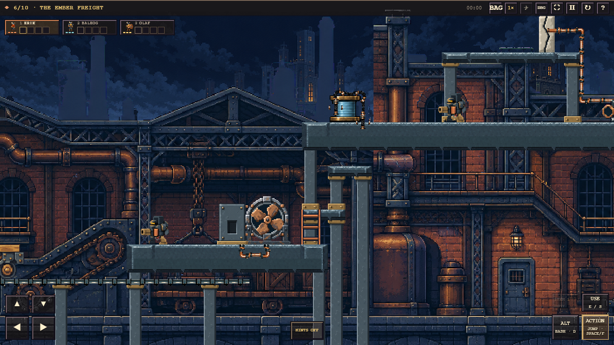
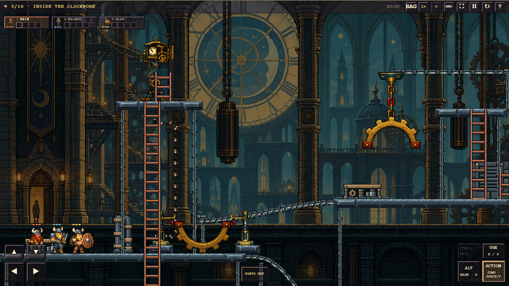
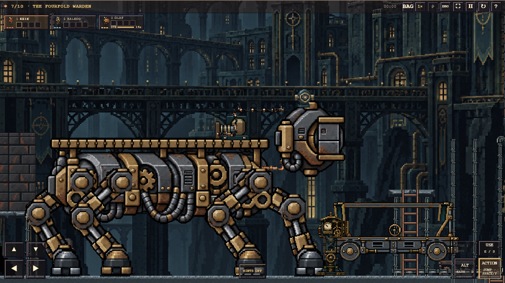
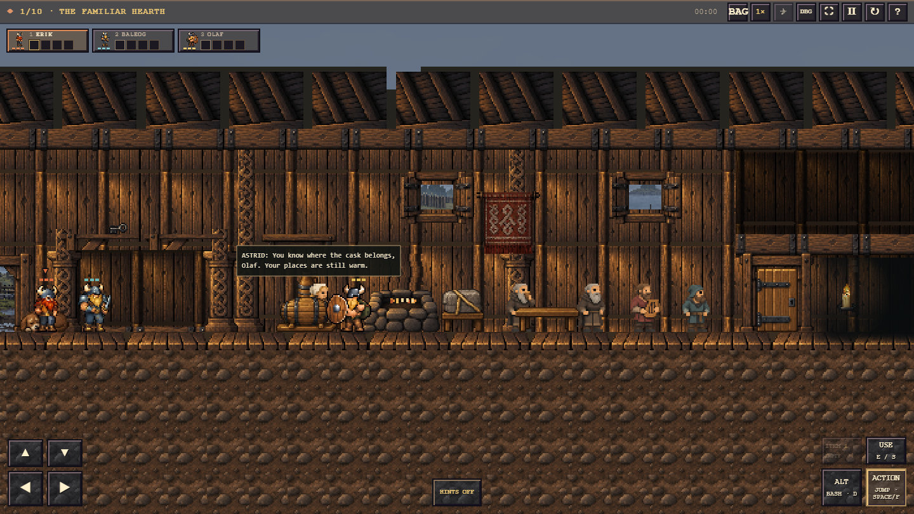
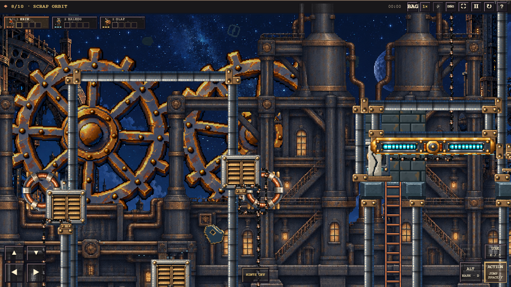

# Last Call — a cooperative Viking puzzle game

**Work in progress. Heavily vibe coded.** A browser-game experiment inspired by
the original *The Lost Vikings*: three distinct heroes, cooperative machinery,
platforming and a strange journey from a familiar Norse tavern into deeper worlds.

[Play the current build](https://united-marsh-6ppd.here.now/)

This project was built through an ongoing conversation with a coding agent,
image generation and repeated hands-on feedback. Most code, art preparation and
tests were agent-authored. The repository preserves experiments, prompts and
review records rather than presenting a polished production codebase. Expect
rough edges, uneven art and animation, bugs and unfinished design. Automated
checks and recorded playthroughs help; they do not make every level or mobile
browser fully validated.

## Screenshots

Current in-engine captures, using the latest Viking sprites. Review-camera framing
shows the larger environments and mechanisms; these are not concept images.

**Ember Freight** — layered industrial scenery, active machinery and the city above
the depot.



| Inside the Clockwork | The Fourfold Warden |
| --- | --- |
|  |  |
| **The Familiar Hearth** — the campaign's lived-in Norse alehall | **Scrap Orbit** — magnetic platforms, crane machinery and giant gears |
|  |  |

## The game

Switch between Erik (running, jumping and bashing), Baleog (sword and bow), and
Olaf (shield, support, pushing and floating). Leave heroes in useful positions,
combine their abilities and bring everyone to the exit. The current campaign,
**The Fall & The Chase**, begins in their regular alehall with a mysterious
creation orb, then descends through sewers, flooded machinery, clockwork,
industrial hazards and magnetic environments. Earlier campaigns and experimental
machine rooms remain available in the level picker.

The Canvas 2D engine includes acceleration-based movement, mobile overlay controls,
inventory, hazards, enemies, multiple zoom levels, layered parallax, synthesized
sound, optical distortion and scripted transitions. These systems are still
evolving alongside the levels.

## Asset creation pipeline

The art workflow became a substantial part of the project:

1. **Brainstorm visually.** Use image generation to explore a room, a mechanism
   and its story purpose. Preserve the concept and exact prompt. A concept image
   is a design reference, not a finished runtime sprite sheet.
2. **Specify the native target first.** Record intended world size, pixel density,
   atlas cells, occupied bounds and contact points. In this engine one native
   pixel occupies **two world units**. Generate deliberate pixel clusters at that
   detail density; shrinking a detailed painting is not an acceptable substitute.
3. **Separate motion from finish.** Native/procedural guides establish poses,
   limb order, contacts and timing; image generation supplies character and
   material rendering. Inspect the full animation for loop drift, invented limbs,
   halos and inconsistent equipment before accepting it.
4. **Prepare and register.** Extract atlas cells, preserve transparency, register
   soles and mounting points, and separate moving parts from static scenery.
   Keep source art and prompts alongside processed assets. Preparation scripts
   live under [`tools/art/`](tools/art/); sources and evidence live under
   [`assets/`](assets/). Earlier pixel-grid-fixer experiments remain documented,
   but cannot rescue a source made at the wrong resolution.
5. **Build the scene in layers.** Far and middle scenery use horizontal and
   vertical parallax. Structural bases, platforms, feet, pipes and cables must
   visibly meet their supports. Static art leaves fire, water and machinery to
   active animation. Preserve rich material shading without breaking the grid.
6. **Review at actual gameplay size.** Source, processed art and real 1×/2× desktop
   and mobile captures receive separate source, runtime and aesthetic verdicts.
   Critique also checks physical causality, grounding and human scale. Dimensions
   and alpha tests alone do not establish quality. See the
   [visual review gate](docs/standards/VISUAL-REVIEW-GATE.md).

## Near one-shot level creation

One experiment here is how close a coding agent can get to creating a complete
level from a single detailed request. Once the engine, art direction and reusable
skills exist, one agent run can carry a concept through visual brainstorming,
puzzle layout, custom mechanisms, generated assets, animation, sound,
implementation, playthrough checks, critique and deployment.

That is **near one-shot within an established project**, not a claim that every
level is correct on its first attempt. The history includes many corrections to
physics, puzzle clarity, scale, animation and art quality. The strongest results
combine a distinctive physical idea, a clear contribution from each hero,
continuous visible consequences and a review loop that catches failures.
Inside the Clockwork and Ember Freight became recurring references for mechanical
coherence, visual richness, atmosphere and rewarding changes of view.

## Skills developed during the project

Lessons from those iterations became reusable agent briefs:

| Skill | What it captures |
| --- | --- |
| [Native sprite art](skills/native-sprite-art/SKILL.md) | Match generation density to display size; preserve material richness; validate animation, equipment, alpha and registration against source and gameplay evidence. |
| [Grounded parallax](skills/grounded-parallax/SKILL.md) | Compose layered worlds with parallax on both axes, coherent supports, decorative room walls and believable adult-human scale. |
| [Cooperative world design](skills/cooperative-world-design/SKILL.md) | Give each place a purpose; evolve challenging, well-paced mechanisms that require real cooperation and make physical sense. |

These skills were created and refined as part of this project. They document a
working method and a quality bar, rather than guaranteeing every historical asset
or level meets the latest rules. [AGENTS.md](AGENTS.md) links the standing
repository instructions and review requirements.

## Run locally

Use Node.js with npm. The core game is a static site with no application backend.
Run commands from the repository root:

```sh
npm install
npm run dev
```

Open `http://127.0.0.1:3000`. To validate and produce a deployable build:

```sh
npm test
npm run build
npm run release:check
```

`npm run test:browser` runs the maintained browser smoke script. Some browser and
art tools currently reference the original development machine's runtime paths;
those need adapting to your local environment. The optional historical
pixel-art-fixer checkout is a submodule; initialize it only if using those tools:

```sh
git submodule update --init tools/pixel-art-fixer
```

## Repository and release layout

Start with the [architecture guide](docs/ARCHITECTURE.md). Runtime code lives in
`src/`, tests in `tests/`, maintained commands in `tools/`, and historical records
in `docs/history/` and `archive/`. Historical patch scripts are development records,
not current mutation or deployment entrypoints.

The explicit [release manifest](config/release-manifest.json) defines what ships.
It preserves flat public module URLs while keeping source grouped by responsibility.
`dist/release-manifest.json` records emitted-file and source SHA256 hashes.
Build output, local credentials and runtime caches are excluded from Git.

The existing here.now publisher consumes that verified build:

```sh
npm run publish:here-now -- --dry-run
```

Without `--dry-run` it updates the project's configured live site and requires
the owner's credentials. Adapt the publisher for your own deployment.

## Credits and scope

### With love for the original

Huge props to the original **The Lost Vikings** and the people who created it.
It is a beloved game, and the reason this project exists: three memorable heroes
with beautifully complementary abilities, clever puzzles, expressive pixel art
and the satisfaction of getting everyone through together. This project is a
fan's tribute to that spirit of cooperation, discovery and character. All credit
for the original game, its characters and the foundational idea belongs to its
creators.

This is an unofficial fan-inspired experiment, not affiliated with the creators
or rights holders of *The Lost Vikings*. AI-generated assets, project-authored
code and historical tooling coexist here; public availability does not change
third-party rights. The optional [pixel-art-fixer](https://github.com/Retro-Diffusion/pixel-art-fixer)
tool retains its own upstream license. No blanket license is asserted for the
whole repository.
