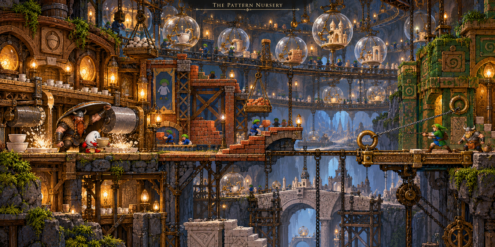
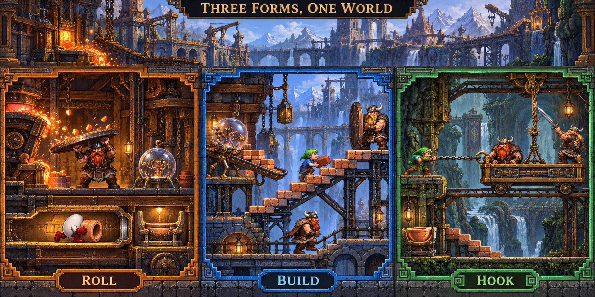
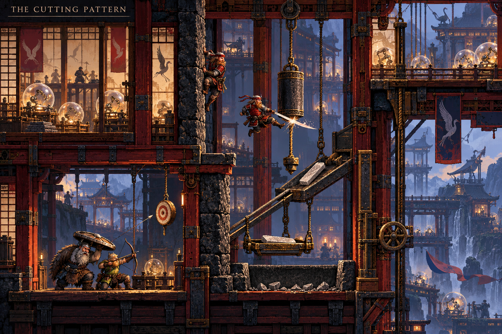

# The Pattern Nursery — transformation level brainstorm

Status: concept exploration, not an implemented or playtested level. Generated
boards illustrate possibilities; they are not runtime sprite sheets or proof of
clearability. Do not add this level to the campaign manifest yet.

## Place in the story

Deeper than the industrial and magnetic works, the Vikings find the place where
the creation orb's kind is made. Dozens of little glass spheres sit in connected
bronze cradles; tiny jointed hands inside each assemble cups, bricks, fasteners
and miniature buildings. Others unfold six legs and carry completed pieces to
the next station. Background work has distinct cycles and physical handoffs.

The orb from the tavern is distinguishable by a chipped brass band and its
familiar, imperfect cups. These are proposed recognition cues, not a new demand
for exposition. Follow the same object's behavior rather than introduce a lore
terminal explaining everything.

The revelation: the orbs do more than make objects. Their work bays impose the
rules under which objects—and bodies—operate. The transformations are functional
testing patterns used to assemble worlds. The crew recognize useful abilities
before understanding what this implies about their own world.

Tone: beautiful, busy, unsettling craft. Preserve the rich clockwork materials
of Inside the Clockwork and the atmosphere/depth of Ember Freight. The orbs are
small precise workers, not enormous mascots. Avoid a row of unrelated arcade
cabinet portals or a generic neon cyberspace corridor.

## Recommended direction: three forms, one construction problem

Use three annexes around one central fabrication carriage and a vertically
stacked route into the nursery. Each transformation creates a persistent,
observable benefit that other heroes can use. These are proposed interpretations
of recognizable game characters, not promises of exact original-game controls.

| Work pattern | New verb and cost | Visual language | Shared result |
| --- | --- | --- | --- |
| Dizzy / egg adventurer | Roll through a body-sized low duct; carry one object at a time | Rounded oak frames, egg/acorn tooling marks, amber glass, mossy storybook masonry; red-gloved white egg silhouette | Fetch a hollow ceramic core and seat it visibly in the forming cradle. It shapes a needed hollow part rather than acting as a generic key. |
| Lemmings worker | Walking, blocker and finite supplied-brick builder jobs continue when deselected | Cobalt workwear, terracotta brick stacks, stepped/diagonal architectural borders, green-haired small worker silhouette | Redirect the walking orb workers into the correct feeder, then build a short service stair the normal crew can traverse. The room's many orbs participate in the puzzle. |
| Link / hookshot adventurer | Grapple fixed iron rings to traverse; haul a wheeled target toward a braced hero | Squared jade/ochre temple blocks, carved spirals, moss, heavy bolted ring hardware, green cap and tunic | Reposition the fabrication tray and reach upper service ledges. The chain transmits force continuously and remains visible. |

Any Viking can enter a pattern; do not hardcode “Erik alone may be Dizzy.” The
identity and inventory underneath remain that Viking's. The other two remain
normal outside the bay, so they still contribute familiar physical abilities.

### Preliminary puzzle progression

1. **Observe one safe cycle.** An orb makes a cup inside its glass, folds its
   arms away, then tips the cup onto a real tray. A dormant test arch briefly
   reshapes an empty calibration dummy, establishing cause and boundary. No
   trial-and-error transformation trap.
2. **Commission the egg pattern.** Retrieve the ceramic core through the low
   duct. Olaf can make a safe roof beneath a clearly telegraphed extrusion chute
   with his overhead shield. Carrying the single core occupies the egg's one
   carry slot. Its outline matches the exposed cradle, and the seated result
   becomes visibly hollow when the orb forms the surrounding material.
3. **Route the makers, then construct access.** A visible stream of little
   six-legged orb workers carries material trays along a loop toward the scrap
   chute. A transformed blocker stands at the fork, making the walkers turn back
   into the forming station's feeder. This behavior is demonstrated safely before
   a tray can be lost; a dropped tray returns by the lower belt. Baleog opens a
   visibly tied cloth feed sack with his sword to supply the brick-making orb.
   A builder can then lay a short real service stair. Its purpose is access to
   machinery, not another long bridge puzzle. Olaf's upright shield is a clear hard end stop for the
   small automatic walker. Provide a lower recovery walkway and cancel/turnaround
   control; do not make switching away a hidden death sentence. Normal Vikings
   use the resulting steps, not just a remote success flag.
4. **Haul the shared workpiece.** The hookshot bay lets the transformed hero reach
   an upper anchor and catch the ring on the fabrication tray. Olaf pushes the
   heavy base into the receiving track; Baleog uses the newly built service
   ledge to cut its exposed rope restraint once the tray is supported. The tray
   rolls along connected rails while the chain stays taut. Ring hardware must
   clearly distinguish a fixed anchor from a wheeled object that can be pulled.
5. **Combine and reunite.** The physical core, constructed access and repositioned
   carriage allow the crew to reach the parent workbench together. The familiar
   orb joins the others but makes a recognizably imperfect cup instead of their
   identical output. Leave what this means open; the next space should invite
   pursuit and investigation. Do not introduce a fourth transformation for the
   finale before the first three are understood.

This sequence still needs a measured layout, movement envelopes and a causal
review before implementation. In particular, verify that the egg shelter is
useful rather than bypassable, the builder route cannot softlock, the tray's
weight/anchoring rules remain consistent, and the finale needs teamwork rather
than three errands for collectible tokens. Generated diagrams may simplify
these relationships; the written rule is authoritative when deciding scope.

## Alternative: The Cutting Pattern

A samurai-inspired annex could replace the hookshot section if stronger vertical
action is preferred. Distinct verbs: wall-cling, wall-kick and a timed blade
parry/cut while airborne. Rough uprights and usable landing ledges make the
movement affordances explicit. Dark lacquer, vermilion timber, indigo cloth,
ivory inspection screens and restrained blade arcs give it a separate visual
language without changing the shared native grid.

Baleog releases a suspended forging blank by shooting its exposed clamp target;
the transformed climber reaches the rope above it. Only when a receiving tray is
underneath should cutting the hemp line lower the blank down an inclined guide.
Olaf shelters the lower work area. A catch basin and reset winch recover a missed
attempt. This is a new wall-movement/timing challenge, not a rule that suddenly
requires a different sword to open the same-looking box.

The samurai alternative is more expensive to animate and validate than the
hookshot: wall contacts, kicks, airborne transitions and parry windows all need
new guides and complete poses. Prefer three well-developed forms over a broad
collection of superficial cameos.

## Transformation contract

- Boundaries are real supported arches and floor inlays with distinct silhouettes,
  materials and motifs. A color tint alone is insufficient; keep them readable
  without color and at 1x. All styles retain the same intended native density.
- Transform on a safe threshold platform through a continuous material/pixel
  sweep. Never resize a collider while wedged in a duct or remove a climbing or
  hook ability in midair. Entry and return include a safe landing/recovery rule.
- Normal inventory remains visible in a bay-side cubby while unavailable to a
  form; nothing vanishes. A form's carried workpiece has an explicit handoff tray.
- The same four actions remain in the same keyboard/mobile locations. Relabel
  them for the form: e.g. BUILD/BLOCK with USE to cancel, or HOOK/RELEASE, with a persistent form and
  active-job indicator during gameplay. Respect the existing cinematic HUD rule.
- Form changes have pose transitions, new locomotion/idle/action frames and
  distinct audio cues. Do not stretch current Viking sprites or paste a costume
  over an incompatible gait. Commission guides and native-density final art
  separately after choosing the concept.
- Constructed steps and moved trays persist; transient tools do not leak powers
  into unrelated areas. Reversing a field cannot destroy the only return route.
- Keep the normal crew adult-sized. An explicitly transformed tiny lemming is
  intentionally smaller; this does not justify oversized everyday furniture.
- Art, supports and connections use native registration and grounded parallax.
  Style boundaries do not produce different pixel sizes, floating foundations or
  invisible collision changes.

## Visual brainstorm files

All images use the built-in image generator. Exact prompts are stored beside the
original generated files under `assets/concepts/pattern-nursery/`:

- `01-pattern-nursery-overview`: the coherent nursery and its three annexes.
- `02-cooperative-transformations`: close views of roll, build and hook causality.
- `03-samurai-rule-chamber`: a vertical action alternative.

Initial visual critique: the atmosphere, material richness and broad shape
languages are useful references. The overview enlarges some orbs beyond the
existing small creation sphere's scale, while the action board simplifies the
egg's protection relationship and duplicates normal Vikings across studies.
The samurai study's echoes are motion studies, not extra playable characters.
Do not copy those scale/cast/connection inconsistencies into geometry. Production
orbs should use measured head-sized cells unless a separate larger parent machine
is deliberately designed. All normal cast scenes still contain exactly three
Vikings. These paintings are not native-density-approved runtime art.

These are design references only. No sprites, level geometry or campaign order
have been changed by this brainstorm.
